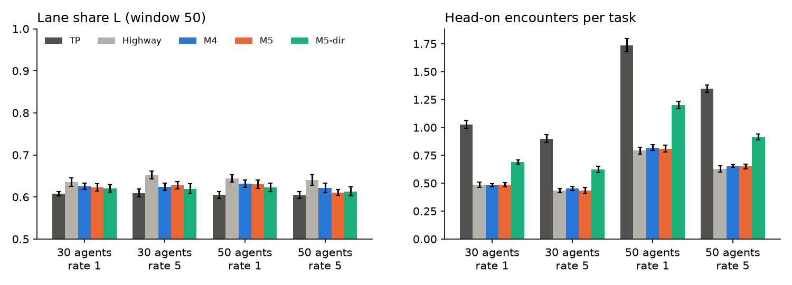
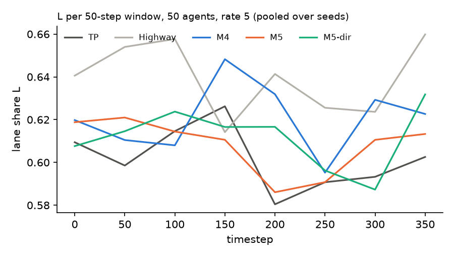

# Lane emergence on narrow_corridor

Question: do robots in the same single-lane aisle end up moving in the same direction
under M5 (Foresight-STD), without a lane rule given in advance? This is the most direct
evidence for contribution 2 (the directional term c_opp).

## Design (fixed 2026-11-24, before any run of this study)

### Corridors

The four interior single-lane aisles of `maps/narrow_corridor.map`: rows 4, 8, 12 and 16,
columns 7-27 (21 cells, entered only from the side aisles in columns 6 and 28). The outer
ring (rows 0, 20) and the vertical aisles are left out: they are not the single-lane
bottlenecks the map was built for, and they connect to everything else.

A **corridor move** is a horizontal move (u -> v, u != v) inside one aisle row, with both
columns in 6-28. That includes stepping in from or out to a side aisle. Moves into and out
of pockets are vertical, so they are not counted. Waits are not moves.

### Primary metric: majority-direction share L

Cut time into windows of 50 steps. For each (corridor, window), let E and W be the numbers
of east and west corridor moves. Then

    L = sum over (corridor, window) of max(E, W)  /  sum over (corridor, window) of (E + W)

per run, i.e. the share of all corridor moves that go in their window's majority
direction. 1 = every aisle is one-way within each window, 0.5 = balanced two-way traffic.
Small windows push L above 0.5 even for random traffic. The bias is the same for every
method on the same seed, so we compare methods by **paired differences**, not by
distance from 0.5.

### Secondary metrics (descriptive; no claims rest on them)

- L with windows of 25 and 100 steps (robustness to the window choice).
- **Flip rate**: for consecutive windows of the same corridor that both have >= 5 moves,
  the share where the majority direction changes. Low = a lane, once formed, persists.
- **L over time**: L per window index, averaged over seeds, to see whether lanes *form*
  during a run or are there from the start.
- Head-on encounters per task (the team's official definition, from the run metrics),
  plotted next to L.

### Methods

| label | method | params | source |
|---|---|---|---|
| TP | M0 | - | - |
| Highway | M1 | w_h = 1.2, `narrow_corridor.highway.json` | `baseline_tuning.md`; imposed one-way aisles, the reference for "full lanes" |
| M4 | Foresight-ST | lam = 0.5, delta = 2 | `tune_foresight.md` |
| M5 | Foresight-STD | lam = 0.5, delta = 2, mu = 0.5, delta_dir = 2 | `tune_foresight.md` |
| M5-dir | Foresight-STD, direction only | lam = 0, delta_dir = 2, mu tuned | see below |

M5-dir (lam = 0) is tuned the same way as M3-M5: tuning seeds 100-104, 30 agents, rates
1 and 5, mu in {0.5, 1, 2, 4}, and the rule in `tune_foresight.md`.

### Runs

Test seeds 0-9; narrow_corridor; 500 tasks; agents {30, 50} x rates {1, 5} (medium and
high load: lanes need traffic). 4 configurations x 10 seeds x 5 methods = 200 runs. Every
run must complete all tasks with 0 conflicts.

### Tests and hypotheses

Paired by (agents, rate, seed); Wilcoxon signed-rank, two-sided, on L (window 50):

- **H1 (contribution 2, main):** L(M5) > L(M4).
- **H2:** L(M5-dir) > L(TP).
- **H3:** L(M4) > L(TP) (time-resolved density alone already separates flows).

Reported per configuration and pooled over all four (40 pairs). Nothing is dropped if a
hypothesis fails; a null H1 is reported as such.

# Findings (written 2026-11-24, after the runs)

**M5-dir tuning** (`tune_foresight_dir_narrow_corridor.toml`, tuning seeds, rule of
`tune_foresight.md`): mean service time 140.6 / 140.5 / 141.0 / 141.3 for
mu = 0.5 / 1 / 2 / 4 (TP 140.8). The near-best set is mu in {0.5, 1, 2}, and the lowest
wait fraction picks **mu = 0.5** (0.054).

**Short version: no lanes form.** Foresight halves head-on encounters on narrow_corridor
by *separating robots in time* (waiting at the aisle entrance until oncoming traffic has
cleared), not by making aisles one-way. M5's directional term adds nothing to lane
formation over M4. Contribution 2, as "lane emergence", is not supported on this map at
the tuned parameters.

1. **H1 fails.** L(M5) - L(M4) = -0.003 pooled (15/40 pairs higher, p = 0.21). The only
   configuration with p < 0.05 (50 agents, rate 5: -0.011, p = 0.027) goes the *wrong*
   way, and does not survive a correction for the 5 tests per hypothesis (0.05 / 5 = 0.01).
2. **H2 and H3 hold but the effect is tiny.** M5-dir +0.012 (32/40, p = 1e-5) and M4
   +0.019 (33/40, p = 9e-7) over TP's 0.61. Even the imposed one-way design (Highway)
   only reaches 0.64. So on this map L has little room to move: most aisle trips are short
   hops to a pocket whose side is fixed by the task, and w_h = 1.2 still lets robots go
   against the lane when that is shorter.
3. **Head-on encounters drop as much as with Highway, but L barely moves.** M4 / M5
   cut encounters by 49-53% vs TP, about the same as Highway (-52 to -54%). At the same time
   the wait fraction rises from 0.04-0.07 to 0.09-0.15, more than Highway's. The
   encounters are avoided by timing, not by direction.
4. **No persistence and no build-up.** Flip rate 0.43-0.51 for TP, M4, M5 and M5-dir:
   an aisle's majority direction is a coin toss from one 50-step window to the next.
   Highway's is 0.38-0.42. L per window shows no upward trend during a run (figure
   below). The 25- and 100-step windows give the same ordering.
5. **Direction-only (M5-dir) is a cheaper middle ground.** It cuts encounters by 30-33%
   with about +50% waiting, against about -50% and +120-150% for M4 / M5, and its service time
   equals TP's. The direction term alone does reduce encounters, just less than the
   time-resolved density term.

**What this means for the report.** Describe contribution 2 honestly: c_opp is a
correct, cheap penalty that reduces head-on encounters on its own (M5-dir), but on top
of rho it is redundant (M5 ~ M4 on every metric, here and in tuning), and neither term
produces emergent lanes on single-lane aisles. The mechanism is temporal separation. That
also explains the higher wait share seen at the mid-term.

Not tried (would need new runs, and a decision first): larger mu with lam > 0;
warehouse_small, where aisles are effectively three cells wide, so robots could form
lanes side by side instead of time-sharing one cell.

# Results

Test seeds 0-9, 200 runs, all complete with 0 conflicts. Produced by `python experiments/lanes.py summarize results/lanes --out results/summary/lanes`.

## Lane share L (window 50; 0.5 = balanced, 1 = one-way)

| agents | rate | TP | Highway | M4 | M5 | M5-dir |
|---:|---:|---:|---:|---:|---:|---:|
| 30 | 1 | 0.608 ± 0.005 | 0.635 ± 0.010 | 0.625 ± 0.008 | 0.623 ± 0.008 | 0.620 ± 0.009 |
| 30 | 5 | 0.609 ± 0.009 | 0.652 ± 0.009 | 0.624 ± 0.009 | 0.628 ± 0.009 | 0.620 ± 0.012 |
| 50 | 1 | 0.605 ± 0.008 | 0.644 ± 0.009 | 0.631 ± 0.009 | 0.630 ± 0.010 | 0.623 ± 0.010 |
| 50 | 5 | 0.605 ± 0.008 | 0.641 ± 0.013 | 0.622 ± 0.011 | 0.611 ± 0.007 | 0.613 ± 0.011 |

## Head-on encounters per task

| agents | rate | TP | Highway | M4 | M5 | M5-dir |
|---:|---:|---:|---:|---:|---:|---:|
| 30 | 1 | 1.028 ± 0.035 | 0.486 ± 0.023 | 0.482 ± 0.016 | 0.488 ± 0.020 | 0.690 ± 0.019 |
| 30 | 5 | 0.900 ± 0.037 | 0.433 ± 0.019 | 0.455 ± 0.018 | 0.435 ± 0.026 | 0.626 ± 0.029 |
| 50 | 1 | 1.738 ± 0.057 | 0.792 ± 0.029 | 0.820 ± 0.027 | 0.810 ± 0.031 | 1.201 ± 0.033 |
| 50 | 5 | 1.347 ± 0.033 | 0.630 ± 0.028 | 0.654 ± 0.013 | 0.651 ± 0.022 | 0.915 ± 0.025 |

## Flip rate (window 50)

| agents | rate | TP | Highway | M4 | M5 | M5-dir |
|---:|---:|---:|---:|---:|---:|---:|
| 30 | 1 | 0.492 ± 0.052 | 0.381 ± 0.059 | 0.507 ± 0.040 | 0.478 ± 0.045 | 0.478 ± 0.046 |
| 30 | 5 | 0.468 ± 0.041 | 0.393 ± 0.064 | 0.455 ± 0.042 | 0.474 ± 0.050 | 0.507 ± 0.044 |
| 50 | 1 | 0.497 ± 0.052 | 0.421 ± 0.050 | 0.508 ± 0.038 | 0.511 ± 0.034 | 0.476 ± 0.046 |
| 50 | 5 | 0.487 ± 0.064 | 0.385 ± 0.056 | 0.464 ± 0.027 | 0.453 ± 0.039 | 0.429 ± 0.062 |

## Lane share, window 25

| agents | rate | TP | Highway | M4 | M5 | M5-dir |
|---:|---:|---:|---:|---:|---:|---:|
| 30 | 1 | 0.648 ± 0.004 | 0.678 ± 0.007 | 0.669 ± 0.008 | 0.667 ± 0.006 | 0.662 ± 0.006 |
| 30 | 5 | 0.654 ± 0.007 | 0.687 ± 0.009 | 0.665 ± 0.010 | 0.667 ± 0.012 | 0.665 ± 0.010 |
| 50 | 1 | 0.639 ± 0.008 | 0.677 ± 0.007 | 0.668 ± 0.008 | 0.671 ± 0.008 | 0.658 ± 0.008 |
| 50 | 5 | 0.639 ± 0.007 | 0.674 ± 0.008 | 0.656 ± 0.009 | 0.653 ± 0.008 | 0.651 ± 0.008 |

## Lane share, window 100

| agents | rate | TP | Highway | M4 | M5 | M5-dir |
|---:|---:|---:|---:|---:|---:|---:|
| 30 | 1 | 0.577 ± 0.010 | 0.609 ± 0.013 | 0.593 ± 0.011 | 0.588 ± 0.007 | 0.588 ± 0.013 |
| 30 | 5 | 0.580 ± 0.008 | 0.626 ± 0.016 | 0.594 ± 0.007 | 0.597 ± 0.010 | 0.584 ± 0.008 |
| 50 | 1 | 0.577 ± 0.007 | 0.622 ± 0.012 | 0.598 ± 0.012 | 0.598 ± 0.013 | 0.588 ± 0.012 |
| 50 | 5 | 0.577 ± 0.010 | 0.616 ± 0.018 | 0.591 ± 0.009 | 0.584 ± 0.006 | 0.591 ± 0.009 |

## Mean service time

| agents | rate | TP | Highway | M4 | M5 | M5-dir |
|---:|---:|---:|---:|---:|---:|---:|
| 30 | 1 | 76.2 ± 2.6 | 78.0 ± 2.2 | 76.7 ± 2.2 | 76.2 ± 1.8 | 76.9 ± 2.5 |
| 30 | 5 | 211.5 ± 3.4 | 214.3 ± 3.6 | 212.0 ± 3.1 | 210.1 ± 2.6 | 211.4 ± 2.8 |
| 50 | 1 | 80.8 ± 1.1 | 81.8 ± 1.7 | 79.3 ± 1.4 | 80.3 ± 1.7 | 79.4 ± 1.8 |
| 50 | 5 | 153.8 ± 2.1 | 156.9 ± 2.9 | 153.1 ± 3.2 | 153.9 ± 2.8 | 154.4 ± 3.3 |

## Wait fraction

| agents | rate | TP | Highway | M4 | M5 | M5-dir |
|---:|---:|---:|---:|---:|---:|---:|
| 30 | 1 | 0.037 ± 0.002 | 0.073 ± 0.005 | 0.091 ± 0.005 | 0.087 ± 0.003 | 0.057 ± 0.003 |
| 30 | 5 | 0.037 ± 0.002 | 0.072 ± 0.004 | 0.088 ± 0.004 | 0.086 ± 0.004 | 0.055 ± 0.002 |
| 50 | 1 | 0.059 ± 0.002 | 0.120 ± 0.005 | 0.131 ± 0.004 | 0.131 ± 0.004 | 0.087 ± 0.003 |
| 50 | 5 | 0.065 ± 0.002 | 0.128 ± 0.007 | 0.147 ± 0.005 | 0.150 ± 0.007 | 0.097 ± 0.004 |

## Paired tests on L (window 50)

Wilcoxon signed-rank, two-sided, paired by (agents, rate, seed). "a higher" = pairs where the first method's L is higher.

| hypothesis | comparison | configuration | pairs | mean difference in L | a higher | p |
|---|---|---|---:|---:|---:|---:|
| H1 | M5 vs M4 | pooled | 40 | -0.0028 | 15/40 | 0.206 |
| H1 | M5 vs M4 | 30 agents, rate 1 | 10 | -0.0025 | 4/10 | 0.557 |
| H1 | M5 vs M4 | 30 agents, rate 5 | 10 | +0.0034 | 4/10 | 0.77 |
| H1 | M5 vs M4 | 50 agents, rate 1 | 10 | -0.0009 | 5/10 | 0.846 |
| H1 | M5 vs M4 | 50 agents, rate 5 | 10 | -0.0111 | 2/10 | 0.0273 |
| H2 | M5-dir vs TP | pooled | 40 | +0.0122 | 32/40 | 9.6e-06 |
| H2 | M5-dir vs TP | 30 agents, rate 1 | 10 | +0.0123 | 8/10 | 0.0371 |
| H2 | M5-dir vs TP | 30 agents, rate 5 | 10 | +0.0103 | 8/10 | 0.0371 |
| H2 | M5-dir vs TP | 50 agents, rate 1 | 10 | +0.0175 | 9/10 | 0.00586 |
| H2 | M5-dir vs TP | 50 agents, rate 5 | 10 | +0.0086 | 7/10 | 0.131 |
| H3 | M4 vs TP | pooled | 40 | +0.0189 | 33/40 | 8.69e-07 |
| H3 | M4 vs TP | 30 agents, rate 1 | 10 | +0.0175 | 9/10 | 0.00586 |
| H3 | M4 vs TP | 30 agents, rate 5 | 10 | +0.0147 | 8/10 | 0.0645 |
| H3 | M4 vs TP | 50 agents, rate 1 | 10 | +0.0261 | 9/10 | 0.00586 |
| H3 | M4 vs TP | 50 agents, rate 5 | 10 | +0.0172 | 7/10 | 0.0645 |

## Figures

