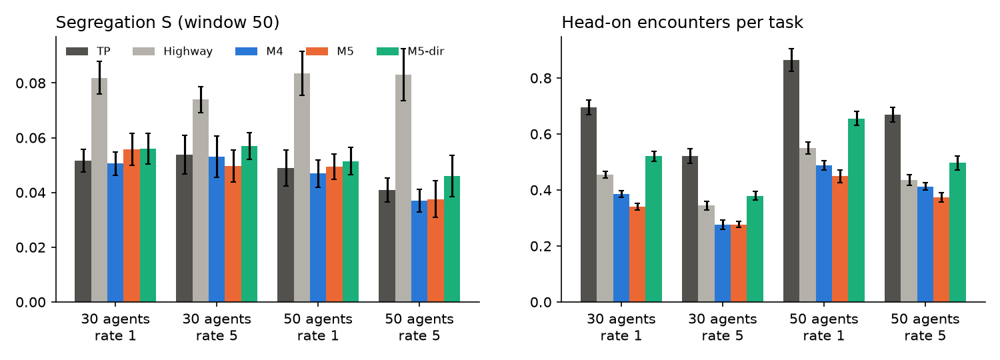
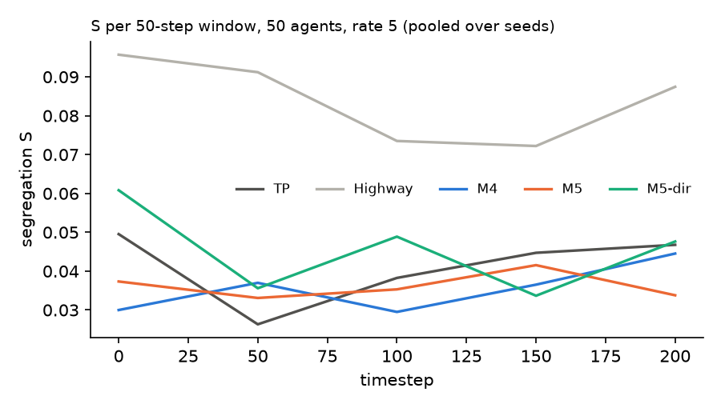

# Lane emergence on warehouse_small

Follow-up to `lanes.md`. On narrow_corridor no lanes formed, but its aisles are one cell
wide, so robots can only time-share them. In warehouse_small each aisle is effectively
three cells wide (the endpoint rows above and below are walkable). Here lanes could form
**side by side**: eastbound robots in one row, westbound robots in another.

## Design (fixed 2026-11-24, before any run of this study)

### Aisle bands

Four interior bands of `maps/warehouse_small.map`, each three rows: {3, 4, 5}, {7, 8, 9},
{11, 12, 13}, {15, 16, 17} (endpoint row, aisle row, endpoint row), columns 6-28. The
outer ring bands (rows 0-1 and 19-20) are left out, as on narrow_corridor. A
**corridor move** is a horizontal move with both cells in one band row and both columns
in 6-28. Waits and vertical moves are not counted.

### Metrics (windows of 50 steps)

- **L_row**: the narrow_corridor lane share computed with each of the 12 rows as its own
  corridor: sum over (row, window) of max(E, W) / sum of (E + W).
- **L_band**: the same with each band (3 rows together) as one corridor.
- **Segregation S = L_row - L_band** (primary). S >= 0 always. S is large when opposing
  flows use different rows of the same band (side-by-side lanes) while the band as a
  whole carries both directions; S = 0 when each row is as mixed as its band.
- Descriptive: share of band moves on the middle (aisle) row, head-on encounters per
  task, wait fraction, mean service time, flip rate per row.

Finer splits give fewer moves per cell, which pushes L_row (and so S) up even for random
traffic. The bias is the same for every method on the same seed, so methods are compared
by paired differences.

### Methods

| label | method | params | source |
|---|---|---|---|
| TP | M0 | - | - |
| Highway | M1 | w_h = 1.5, `warehouse_small.highway.json` | `baseline_tuning.md` (only the aisle rows have a direction) |
| M4 | Foresight-ST | lam = 2, delta = 10 | `tune_foresight.md` |
| M5 | Foresight-STD | lam = 2, delta = 10, mu = 4, delta_dir = 2 | `tune_foresight.md` |
| M5-dir | Foresight-STD, lam = 0 | delta_dir = 2, mu tuned | tuning seeds 100-104, 30 agents, rates 1 and 5, mu in {0.5, 1, 2, 4}, rule of `tune_foresight.md` |

### Runs

Test seeds 0-9; 500 tasks; agents {30, 50} x rates {1, 5}; 200 runs, all of which must
complete with 0 conflicts.

### Hypotheses

Paired by (agents, rate, seed); Wilcoxon signed-rank, two-sided, on S:

- **W1 (main):** S(M5) > S(M4). The directional term sorts opposing flows into rows.
- **W2:** S(M5-dir) > S(TP).
- **W3:** S(M4) > S(TP).

Also reported, same tests, on L_row. Per configuration and pooled (40 pairs). Nothing is
dropped if a hypothesis fails.

# Findings (written 2026-11-24, after the runs)

**M5-dir tuning** (`tune_foresight_dir_warehouse_small.toml`, tuning seeds): mean service
time 92.7 / 92.7 / 92.7 / 92.9 for mu = 0.5 / 1 / 2 / 4 (TP 93.2); all four settings
are near-best. mu = 0.5 and 1 produced identical runs, and the tie goes to **mu = 0.5**.

**Short version: no side-by-side lanes either.** With three walkable rows per aisle,
Foresight still does not sort opposing flows into different rows. Imposed one-way
aisle rows (Highway) do.

1. **W1 fails.** S(M5) - S(M4) = +0.001 pooled (22/40, p = 0.50). On L_row the only
   significant configuration is 30 agents, rate 1 (+0.011, 10/10, p = 0.002). The
   pooled difference is +0.002 (p = 0.21).
2. **W2 holds but is tiny; W3 fails.** M5-dir +0.004 in S over TP (25/40, p = 0.014),
   with S at ~0.05. M4 -0.002 (p = 0.26). Highway is the only method with clear
   segregation: S 0.074-0.084 vs TP 0.041-0.054, flip rate 0.31-0.35 vs ~0.5. It does
   this by pushing traffic *off* the directed aisle row: the middle-row share falls from
   0.23-0.32 to 0.16-0.25, so robots going against the lane use the endpoint rows.
3. **Foresight moves traffic onto the aisle row instead.** The middle-row share rises to
   0.28-0.35 for M4 / M5, probably because parked and pocket-bound robots make the
   endpoint rows look busy in rho. The aisle row stays two-way.
4. **Head-on encounters: M4 / M5 beat Highway without lanes.** M4 cuts encounters
   by 38-47% vs TP, M5 by 44-51%, Highway by 34-36%. Waiting rises +23-41% for
   M4 / M5 vs +4-11% for Highway. As on narrow_corridor, robots avoid encounters by
   timing, not by direction.
5. **Exploratory (not a pre-registered test): M5 < M4 on head-on encounters here.**
   M5 - M4 = -0.030 per task pooled (M5 lower in 30/40 pairs, Wilcoxon p = 1e-4),
   about -8%, and lower in 3 of 4 configurations. Service time is equal or slightly
   better (-0.1% to -0.7%). This is with the tuned mu = 4, delta = 10; at the mid-term
   (mu = 1, delta = 2) M5 ~ M4. It is the first test-seed sign that c_opp adds something
   on top of rho, but through fewer encounters, not through lanes. The main experiments
   should confirm it as a planned comparison before the report claims it.

**Combined with `lanes.md`:** on neither map does Foresight produce lanes, one-way or side
by side. Its encounter reduction is temporal separation in both. Contribution 2 should be
framed as "a directional penalty that further reduces head-on encounters on wide aisles
(warehouse, tuned mu)", if the main experiments confirm finding 5, not as lane emergence.

# Results

Test seeds 0-9, 200 runs, all complete with 0 conflicts. Produced by `python experiments/lanes.py summarize results/lanes_warehouse --map warehouse_small --out results/summary/lanes_warehouse`.

## Segregation S = L_row - L_band (window 50)

| agents | rate | TP | Highway | M4 | M5 | M5-dir |
|---:|---:|---:|---:|---:|---:|---:|
| 30 | 1 | 0.052 ± 0.004 | 0.082 ± 0.006 | 0.051 ± 0.004 | 0.056 ± 0.006 | 0.056 ± 0.006 |
| 30 | 5 | 0.054 ± 0.007 | 0.074 ± 0.005 | 0.053 ± 0.008 | 0.050 ± 0.006 | 0.057 ± 0.005 |
| 50 | 1 | 0.049 ± 0.007 | 0.084 ± 0.008 | 0.047 ± 0.005 | 0.049 ± 0.005 | 0.051 ± 0.005 |
| 50 | 5 | 0.041 ± 0.004 | 0.083 ± 0.009 | 0.037 ± 0.004 | 0.038 ± 0.007 | 0.046 ± 0.008 |

## L_row (each row its own corridor, window 50)

| agents | rate | TP | Highway | M4 | M5 | M5-dir |
|---:|---:|---:|---:|---:|---:|---:|
| 30 | 1 | 0.629 ± 0.004 | 0.662 ± 0.006 | 0.627 ± 0.008 | 0.638 ± 0.007 | 0.635 ± 0.006 |
| 30 | 5 | 0.636 ± 0.008 | 0.656 ± 0.005 | 0.631 ± 0.003 | 0.630 ± 0.005 | 0.639 ± 0.005 |
| 50 | 1 | 0.624 ± 0.006 | 0.674 ± 0.006 | 0.627 ± 0.004 | 0.627 ± 0.005 | 0.628 ± 0.005 |
| 50 | 5 | 0.612 ± 0.005 | 0.667 ± 0.006 | 0.608 ± 0.009 | 0.608 ± 0.003 | 0.618 ± 0.010 |

## L_band (each 3-row band one corridor, window 50)

| agents | rate | TP | Highway | M4 | M5 | M5-dir |
|---:|---:|---:|---:|---:|---:|---:|
| 30 | 1 | 0.577 ± 0.005 | 0.580 ± 0.005 | 0.576 ± 0.006 | 0.582 ± 0.006 | 0.579 ± 0.007 |
| 30 | 5 | 0.582 ± 0.009 | 0.582 ± 0.005 | 0.578 ± 0.007 | 0.580 ± 0.007 | 0.582 ± 0.007 |
| 50 | 1 | 0.575 ± 0.005 | 0.590 ± 0.006 | 0.580 ± 0.004 | 0.577 ± 0.007 | 0.576 ± 0.006 |
| 50 | 5 | 0.571 ± 0.007 | 0.584 ± 0.005 | 0.571 ± 0.009 | 0.571 ± 0.006 | 0.572 ± 0.010 |

## Head-on encounters per task

| agents | rate | TP | Highway | M4 | M5 | M5-dir |
|---:|---:|---:|---:|---:|---:|---:|
| 30 | 1 | 0.694 ± 0.026 | 0.453 ± 0.012 | 0.386 ± 0.011 | 0.341 ± 0.012 | 0.520 ± 0.018 |
| 30 | 5 | 0.521 ± 0.026 | 0.345 ± 0.015 | 0.276 ± 0.018 | 0.277 ± 0.011 | 0.379 ± 0.016 |
| 50 | 1 | 0.863 ± 0.040 | 0.550 ± 0.022 | 0.488 ± 0.017 | 0.449 ± 0.022 | 0.655 ± 0.025 |
| 50 | 5 | 0.669 ± 0.026 | 0.435 ± 0.019 | 0.412 ± 0.013 | 0.374 ± 0.016 | 0.497 ± 0.025 |

## Share of band moves on the middle (aisle) row

| agents | rate | TP | Highway | M4 | M5 | M5-dir |
|---:|---:|---:|---:|---:|---:|---:|
| 30 | 1 | 0.232 ± 0.006 | 0.163 ± 0.006 | 0.285 ± 0.005 | 0.287 ± 0.004 | 0.239 ± 0.007 |
| 30 | 5 | 0.225 ± 0.008 | 0.161 ± 0.007 | 0.278 ± 0.007 | 0.280 ± 0.005 | 0.234 ± 0.007 |
| 50 | 1 | 0.316 ± 0.006 | 0.249 ± 0.009 | 0.345 ± 0.005 | 0.352 ± 0.009 | 0.329 ± 0.004 |
| 50 | 5 | 0.319 ± 0.004 | 0.249 ± 0.008 | 0.336 ± 0.003 | 0.342 ± 0.006 | 0.328 ± 0.007 |

## Flip rate per row (window 50)

| agents | rate | TP | Highway | M4 | M5 | M5-dir |
|---:|---:|---:|---:|---:|---:|---:|
| 30 | 1 | 0.520 ± 0.022 | 0.345 ± 0.025 | 0.484 ± 0.015 | 0.499 ± 0.015 | 0.492 ± 0.022 |
| 30 | 5 | 0.492 ± 0.032 | 0.350 ± 0.036 | 0.481 ± 0.029 | 0.449 ± 0.047 | 0.466 ± 0.035 |
| 50 | 1 | 0.507 ± 0.029 | 0.305 ± 0.025 | 0.513 ± 0.030 | 0.504 ± 0.021 | 0.514 ± 0.021 |
| 50 | 5 | 0.487 ± 0.052 | 0.336 ± 0.053 | 0.530 ± 0.049 | 0.531 ± 0.039 | 0.466 ± 0.057 |

## Segregation, window 25

| agents | rate | TP | Highway | M4 | M5 | M5-dir |
|---:|---:|---:|---:|---:|---:|---:|
| 30 | 1 | 0.067 ± 0.005 | 0.088 ± 0.006 | 0.069 ± 0.005 | 0.072 ± 0.005 | 0.070 ± 0.007 |
| 30 | 5 | 0.072 ± 0.004 | 0.081 ± 0.006 | 0.067 ± 0.008 | 0.068 ± 0.007 | 0.073 ± 0.003 |
| 50 | 1 | 0.064 ± 0.005 | 0.091 ± 0.006 | 0.066 ± 0.006 | 0.065 ± 0.005 | 0.066 ± 0.004 |
| 50 | 5 | 0.054 ± 0.004 | 0.092 ± 0.008 | 0.052 ± 0.005 | 0.055 ± 0.004 | 0.058 ± 0.006 |

## Segregation, window 100

| agents | rate | TP | Highway | M4 | M5 | M5-dir |
|---:|---:|---:|---:|---:|---:|---:|
| 30 | 1 | 0.038 ± 0.005 | 0.074 ± 0.009 | 0.037 ± 0.006 | 0.041 ± 0.008 | 0.040 ± 0.006 |
| 30 | 5 | 0.040 ± 0.007 | 0.065 ± 0.005 | 0.038 ± 0.007 | 0.040 ± 0.007 | 0.042 ± 0.005 |
| 50 | 1 | 0.036 ± 0.007 | 0.079 ± 0.012 | 0.034 ± 0.004 | 0.037 ± 0.003 | 0.037 ± 0.006 |
| 50 | 5 | 0.034 ± 0.005 | 0.080 ± 0.009 | 0.027 ± 0.004 | 0.027 ± 0.005 | 0.034 ± 0.005 |

## Mean service time

| agents | rate | TP | Highway | M4 | M5 | M5-dir |
|---:|---:|---:|---:|---:|---:|---:|
| 30 | 1 | 40.7 ± 0.4 | 40.8 ± 0.3 | 40.4 ± 0.4 | 40.4 ± 0.3 | 40.5 ± 0.4 |
| 30 | 5 | 149.6 ± 2.8 | 148.6 ± 2.4 | 146.7 ± 2.9 | 146.5 ± 2.2 | 148.1 ± 2.5 |
| 50 | 1 | 44.6 ± 0.6 | 44.7 ± 0.7 | 44.0 ± 0.4 | 44.0 ± 0.7 | 44.6 ± 0.5 |
| 50 | 5 | 96.2 ± 2.0 | 95.6 ± 1.5 | 94.1 ± 1.6 | 93.4 ± 1.4 | 95.4 ± 2.0 |

## Wait fraction

| agents | rate | TP | Highway | M4 | M5 | M5-dir |
|---:|---:|---:|---:|---:|---:|---:|
| 30 | 1 | 0.044 ± 0.003 | 0.049 ± 0.003 | 0.062 ± 0.004 | 0.057 ± 0.003 | 0.048 ± 0.002 |
| 30 | 5 | 0.050 ± 0.004 | 0.055 ± 0.003 | 0.067 ± 0.005 | 0.068 ± 0.004 | 0.052 ± 0.003 |
| 50 | 1 | 0.052 ± 0.003 | 0.057 ± 0.002 | 0.070 ± 0.004 | 0.064 ± 0.003 | 0.056 ± 0.002 |
| 50 | 5 | 0.068 ± 0.003 | 0.071 ± 0.004 | 0.091 ± 0.005 | 0.086 ± 0.004 | 0.072 ± 0.004 |

## Paired tests on S (window 50)

Wilcoxon signed-rank, two-sided, paired by (agents, rate, seed). "a higher" = pairs where the first method's value is higher.

| hypothesis | comparison | configuration | pairs | mean difference | a higher | p |
|---|---|---|---:|---:|---:|---:|
| W1 | M5 vs M4 | pooled | 40 | +0.0012 | 22/40 | 0.501 |
| W1 | M5 vs M4 | 30 agents, rate 1 | 10 | +0.0051 | 7/10 | 0.16 |
| W1 | M5 vs M4 | 30 agents, rate 5 | 10 | -0.0034 | 5/10 | 0.557 |
| W1 | M5 vs M4 | 50 agents, rate 1 | 10 | +0.0025 | 6/10 | 0.557 |
| W1 | M5 vs M4 | 50 agents, rate 5 | 10 | +0.0006 | 4/10 | 1 |
| W2 | M5-dir vs TP | pooled | 40 | +0.0038 | 25/40 | 0.0141 |
| W2 | M5-dir vs TP | 30 agents, rate 1 | 10 | +0.0044 | 7/10 | 0.105 |
| W2 | M5-dir vs TP | 30 agents, rate 5 | 10 | +0.0033 | 6/10 | 0.322 |
| W2 | M5-dir vs TP | 50 agents, rate 1 | 10 | +0.0025 | 5/10 | 0.625 |
| W2 | M5-dir vs TP | 50 agents, rate 5 | 10 | +0.0051 | 7/10 | 0.131 |
| W3 | M4 vs TP | pooled | 40 | -0.0019 | 18/40 | 0.259 |
| W3 | M4 vs TP | 30 agents, rate 1 | 10 | -0.0011 | 6/10 | 1 |
| W3 | M4 vs TP | 30 agents, rate 5 | 10 | -0.0007 | 6/10 | 0.922 |
| W3 | M4 vs TP | 50 agents, rate 1 | 10 | -0.0020 | 3/10 | 0.492 |
| W3 | M4 vs TP | 50 agents, rate 5 | 10 | -0.0039 | 3/10 | 0.16 |

## Paired tests on L_row (window 50)

Wilcoxon signed-rank, two-sided, paired by (agents, rate, seed). "a higher" = pairs where the first method's value is higher.

| hypothesis | comparison | configuration | pairs | mean difference | a higher | p |
|---|---|---|---:|---:|---:|---:|
| W1 | M5 vs M4 | pooled | 40 | +0.0024 | 24/40 | 0.206 |
| W1 | M5 vs M4 | 30 agents, rate 1 | 10 | +0.0111 | 10/10 | 0.00195 |
| W1 | M5 vs M4 | 30 agents, rate 5 | 10 | -0.0012 | 4/10 | 0.695 |
| W1 | M5 vs M4 | 50 agents, rate 1 | 10 | -0.0001 | 4/10 | 1 |
| W1 | M5 vs M4 | 50 agents, rate 5 | 10 | -0.0000 | 6/10 | 1 |
| W2 | M5-dir vs TP | pooled | 40 | +0.0047 | 26/40 | 0.0332 |
| W2 | M5-dir vs TP | 30 agents, rate 1 | 10 | +0.0061 | 8/10 | 0.105 |
| W2 | M5-dir vs TP | 30 agents, rate 5 | 10 | +0.0029 | 7/10 | 0.375 |
| W2 | M5-dir vs TP | 50 agents, rate 1 | 10 | +0.0038 | 6/10 | 0.492 |
| W2 | M5-dir vs TP | 50 agents, rate 5 | 10 | +0.0061 | 5/10 | 0.375 |
| W3 | M4 vs TP | pooled | 40 | -0.0019 | 18/40 | 0.468 |
| W3 | M4 vs TP | 30 agents, rate 1 | 10 | -0.0020 | 5/10 | 0.846 |
| W3 | M4 vs TP | 30 agents, rate 5 | 10 | -0.0050 | 4/10 | 0.322 |
| W3 | M4 vs TP | 50 agents, rate 1 | 10 | +0.0029 | 6/10 | 0.432 |
| W3 | M4 vs TP | 50 agents, rate 5 | 10 | -0.0034 | 3/10 | 0.557 |

## Figures

