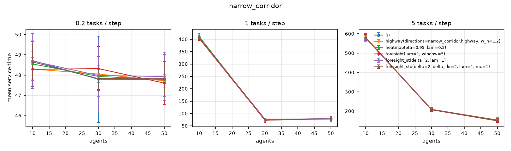
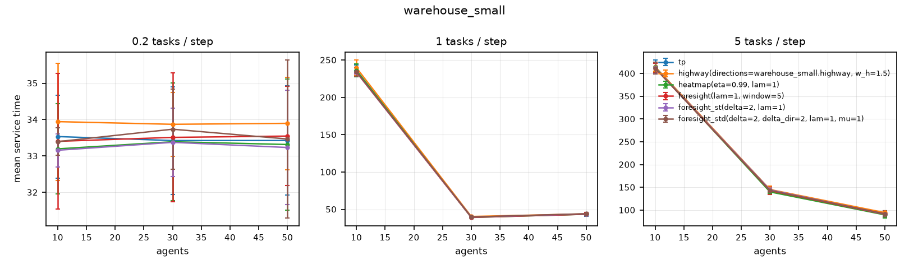

# midterm

Source: results/midterm.csv, results/midterm_narrow.csv. 324 runs used.
Cells: mean service time, mean ± 95% CI over seeds. Tests pair each variant with `tp` on the same (agents, rate, seed); change is the mean relative difference.

## narrow_corridor

| agents | rate | tp | highway(directions=narrow_corridor.highway, w_h=1.2) | heatmap(eta=0.95, lam=0.5) | foresight(lam=1, window=5) | foresight_st(delta=2, lam=1) | foresight_std(delta=2, delta_dir=2, lam=1, mu=1) |
|---:|---:|---:|---:|---:|---:|---:|---:|
| 10 | 0.2 | 48.7 ± 1.0 | 48.3 ± 0.6 | 48.5 ± 1.1 | 48.3 ± 0.9 | 48.7 ± 1.4 | 48.7 ± 0.9 |
| 10 | 1 | 405.6 ± 2.8 | 407.4 ± 5.9 | 411.9 ± 10.9 | 403.9 ± 9.0 | 406.9 ± 3.3 | 406.4 ± 3.4 |
| 10 | 5 | 578.7 ± 14.3 | 582.8 ± 13.2 | 579.8 ± 14.4 | 579.6 ± 17.5 | 579.2 ± 14.1 | 581.1 ± 20.0 |
| 30 | 0.2 | 47.8 ± 2.1 | 48.1 ± 0.4 | 47.9 ± 1.0 | 48.3 ± 1.1 | 48.0 ± 1.8 | 47.8 ± 0.5 |
| 30 | 1 | 74.4 ± 3.8 | 74.8 ± 1.6 | 73.1 ± 4.2 | 72.8 ± 8.8 | 75.7 ± 1.4 | 77.3 ± 2.3 |
| 30 | 5 | 208.0 ± 7.1 | 209.2 ± 7.7 | 207.1 ± 6.1 | 207.4 ± 8.8 | 209.4 ± 9.1 | 209.0 ± 4.5 |
| 50 | 0.2 | 47.8 ± 1.2 | 47.7 ± 0.3 | 47.8 ± 1.2 | 47.6 ± 1.1 | 47.9 ± 1.2 | 47.8 ± 0.9 |
| 50 | 1 | 79.7 ± 3.8 | 79.9 ± 3.6 | 78.5 ± 6.2 | 79.6 ± 4.2 | 79.9 ± 7.0 | 77.8 ± 11.0 |
| 50 | 5 | 153.1 ± 9.5 | 154.5 ± 12.6 | 149.5 ± 5.7 | 150.7 ± 9.1 | 153.3 ± 6.2 | 153.3 ± 8.6 |

### Paired tests vs `tp`

| variant | metric | pairs | change vs reference | better in | p (Wilcoxon) |
|---|---|---:|---:|---:|---:|
| foresight(lam=1, window=5) | mean service time | 27 | -0.5% | 15/27 | 0.22 |
| foresight(lam=1, window=5) | 95th pct service time | 27 | -0.3% | 12/27 | 0.605 |
| foresight(lam=1, window=5) | wait fraction | 27 | +88.8% | 0/27 | 1.49e-08 |
| foresight(lam=1, window=5) | head-on encounters per task | 27 | -27.7% | 27/27 | 5.6e-06 |
| foresight(lam=1, window=5) | planning ms per step | 27 | +78.2% | 3/27 | 2.09e-07 |
| foresight_st(delta=2, lam=1) | mean service time | 27 | +0.4% | 11/27 | 0.207 |
| foresight_st(delta=2, lam=1) | 95th pct service time | 27 | +0.7% | 11/27 | 0.128 |
| foresight_st(delta=2, lam=1) | wait fraction | 27 | +162.2% | 0/27 | 1.49e-08 |
| foresight_st(delta=2, lam=1) | head-on encounters per task | 27 | -52.7% | 27/27 | 1.49e-08 |
| foresight_st(delta=2, lam=1) | planning ms per step | 27 | +70.5% | 0/27 | 1.49e-08 |
| foresight_std(delta=2, delta_dir=2, lam=1, mu=1) | mean service time | 27 | +0.3% | 13/27 | 0.258 |
| foresight_std(delta=2, delta_dir=2, lam=1, mu=1) | 95th pct service time | 27 | -0.4% | 17/27 | 0.509 |
| foresight_std(delta=2, delta_dir=2, lam=1, mu=1) | wait fraction | 27 | +160.5% | 0/27 | 1.49e-08 |
| foresight_std(delta=2, delta_dir=2, lam=1, mu=1) | head-on encounters per task | 27 | -53.7% | 27/27 | 5.6e-06 |
| foresight_std(delta=2, delta_dir=2, lam=1, mu=1) | planning ms per step | 27 | +102.0% | 0/27 | 1.49e-08 |
| heatmap(eta=0.95, lam=0.5) | mean service time | 27 | -0.5% | 16/27 | 0.515 |
| heatmap(eta=0.95, lam=0.5) | 95th pct service time | 27 | -0.8% | 11/27 | 0.524 |
| heatmap(eta=0.95, lam=0.5) | wait fraction | 27 | +148.9% | 0/27 | 1.49e-08 |
| heatmap(eta=0.95, lam=0.5) | head-on encounters per task | 27 | -51.0% | 27/27 | 5.6e-06 |
| heatmap(eta=0.95, lam=0.5) | planning ms per step | 27 | +125.2% | 1/27 | 4.47e-08 |
| highway(directions=narrow_corridor.highway, w_h=1.2) | mean service time | 27 | +0.4% | 12/27 | 0.0385 |
| highway(directions=narrow_corridor.highway, w_h=1.2) | 95th pct service time | 27 | -0.0% | 9/27 | 0.158 |
| highway(directions=narrow_corridor.highway, w_h=1.2) | wait fraction | 27 | +103.2% | 0/27 | 1.49e-08 |
| highway(directions=narrow_corridor.highway, w_h=1.2) | head-on encounters per task | 27 | -49.3% | 27/27 | 1.49e-08 |
| highway(directions=narrow_corridor.highway, w_h=1.2) | planning ms per step | 27 | +56.2% | 0/27 | 1.49e-08 |

## warehouse_small

| agents | rate | tp | highway(directions=warehouse_small.highway, w_h=1.5) | heatmap(eta=0.99, lam=1) | foresight(lam=1, window=5) | foresight_st(delta=2, lam=1) | foresight_std(delta=2, delta_dir=2, lam=1, mu=1) |
|---:|---:|---:|---:|---:|---:|---:|---:|
| 10 | 0.2 | 33.5 ± 1.1 | 33.9 ± 1.6 | 33.2 ± 1.2 | 33.4 ± 1.9 | 33.2 ± 0.5 | 33.4 ± 0.4 |
| 10 | 1 | 236.1 ± 7.6 | 239.7 ± 10.5 | 236.2 ± 8.6 | 233.7 ± 2.1 | 233.9 ± 1.9 | 234.3 ± 5.7 |
| 10 | 5 | 414.7 ± 15.3 | 414.7 ± 10.1 | 413.3 ± 10.6 | 411.9 ± 10.9 | 412.4 ± 12.6 | 411.6 ± 12.7 |
| 30 | 0.2 | 33.4 ± 1.5 | 33.9 ± 0.9 | 33.4 ± 1.6 | 33.5 ± 1.8 | 33.4 ± 0.9 | 33.7 ± 1.1 |
| 30 | 1 | 39.9 ± 0.3 | 40.5 ± 1.2 | 39.2 ± 0.9 | 39.3 ± 0.5 | 39.7 ± 1.2 | 39.8 ± 1.2 |
| 30 | 5 | 144.6 ± 3.0 | 145.2 ± 7.9 | 140.0 ± 3.7 | 142.6 ± 8.3 | 144.4 ± 4.9 | 143.1 ± 4.6 |
| 50 | 0.2 | 33.4 ± 1.5 | 33.9 ± 1.3 | 33.3 ± 1.8 | 33.5 ± 1.4 | 33.2 ± 1.6 | 33.5 ± 2.2 |
| 50 | 1 | 43.5 ± 2.5 | 43.9 ± 0.9 | 43.5 ± 1.4 | 43.5 ± 2.2 | 43.9 ± 0.8 | 44.2 ± 0.4 |
| 50 | 5 | 93.1 ± 5.1 | 94.4 ± 4.1 | 89.6 ± 7.2 | 90.8 ± 5.9 | 91.4 ± 5.3 | 91.9 ± 6.9 |

### Paired tests vs `tp`

| variant | metric | pairs | change vs reference | better in | p (Wilcoxon) |
|---|---|---:|---:|---:|---:|
| foresight(lam=1, window=5) | mean service time | 27 | -0.8% | 19/27 | 0.014 |
| foresight(lam=1, window=5) | 95th pct service time | 27 | -0.3% | 12/27 | 0.398 |
| foresight(lam=1, window=5) | wait fraction | 27 | +12.7% | 5/27 | 2.59e-05 |
| foresight(lam=1, window=5) | head-on encounters per task | 27 | -31.2% | 27/27 | 5.6e-06 |
| foresight(lam=1, window=5) | planning ms per step | 27 | +69.4% | 0/27 | 1.49e-08 |
| foresight_st(delta=2, lam=1) | mean service time | 27 | -0.6% | 19/27 | 0.0125 |
| foresight_st(delta=2, lam=1) | 95th pct service time | 27 | -0.5% | 16/27 | 0.0456 |
| foresight_st(delta=2, lam=1) | wait fraction | 27 | +56.2% | 0/27 | 1.49e-08 |
| foresight_st(delta=2, lam=1) | head-on encounters per task | 27 | -49.8% | 27/27 | 5.59e-06 |
| foresight_st(delta=2, lam=1) | planning ms per step | 27 | +69.7% | 0/27 | 1.49e-08 |
| foresight_std(delta=2, delta_dir=2, lam=1, mu=1) | mean service time | 27 | -0.2% | 17/27 | 0.0577 |
| foresight_std(delta=2, delta_dir=2, lam=1, mu=1) | 95th pct service time | 27 | -0.5% | 15/27 | 0.0365 |
| foresight_std(delta=2, delta_dir=2, lam=1, mu=1) | wait fraction | 27 | +55.9% | 0/27 | 1.49e-08 |
| foresight_std(delta=2, delta_dir=2, lam=1, mu=1) | head-on encounters per task | 27 | -48.9% | 27/27 | 5.6e-06 |
| foresight_std(delta=2, delta_dir=2, lam=1, mu=1) | planning ms per step | 27 | +120.6% | 0/27 | 1.49e-08 |
| heatmap(eta=0.99, lam=1) | mean service time | 27 | -1.2% | 21/27 | 0.00547 |
| heatmap(eta=0.99, lam=1) | 95th pct service time | 27 | -1.1% | 20/27 | 0.016 |
| heatmap(eta=0.99, lam=1) | wait fraction | 27 | +22.5% | 6/27 | 0.000143 |
| heatmap(eta=0.99, lam=1) | head-on encounters per task | 27 | -51.6% | 27/27 | 1.49e-08 |
| heatmap(eta=0.99, lam=1) | planning ms per step | 27 | +178.9% | 0/27 | 1.49e-08 |
| highway(directions=warehouse_small.highway, w_h=1.5) | mean service time | 27 | +1.1% | 5/27 | 0.00663 |
| highway(directions=warehouse_small.highway, w_h=1.5) | 95th pct service time | 27 | +1.4% | 10/27 | 0.529 |
| highway(directions=warehouse_small.highway, w_h=1.5) | wait fraction | 27 | +12.2% | 6/27 | 0.000536 |
| highway(directions=warehouse_small.highway, w_h=1.5) | head-on encounters per task | 27 | -38.6% | 27/27 | 5.59e-06 |
| highway(directions=warehouse_small.highway, w_h=1.5) | planning ms per step | 27 | +77.2% | 0/27 | 1.49e-08 |
