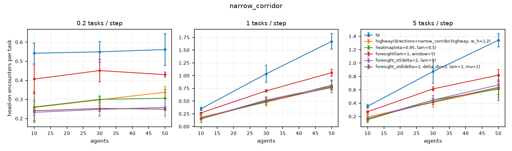
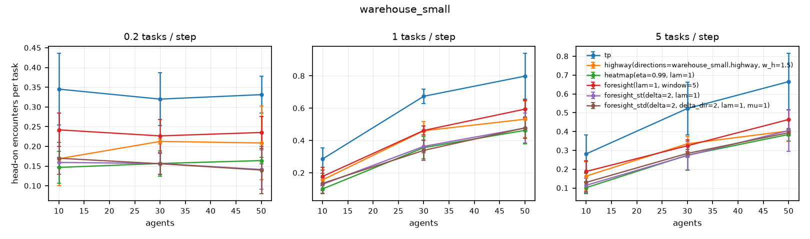

# midterm_head_on

Source: results/midterm.csv, results/midterm_narrow.csv. 324 runs used.
Cells: head-on encounters per task, mean ± 95% CI over seeds. Tests pair each variant with `tp` on the same (agents, rate, seed); change is the mean relative difference.

## narrow_corridor

| agents | rate | tp | highway(directions=narrow_corridor.highway, w_h=1.2) | heatmap(eta=0.95, lam=0.5) | foresight(lam=1, window=5) | foresight_st(delta=2, lam=1) | foresight_std(delta=2, delta_dir=2, lam=1, mu=1) |
|---:|---:|---:|---:|---:|---:|---:|---:|
| 10 | 0.2 | 0.542 ± 0.054 | 0.258 ± 0.077 | 0.261 ± 0.081 | 0.407 ± 0.074 | 0.233 ± 0.014 | 0.241 ± 0.052 |
| 10 | 1 | 0.348 ± 0.033 | 0.184 ± 0.052 | 0.167 ± 0.029 | 0.269 ± 0.013 | 0.157 ± 0.025 | 0.151 ± 0.070 |
| 10 | 5 | 0.353 ± 0.030 | 0.195 ± 0.060 | 0.152 ± 0.040 | 0.271 ± 0.017 | 0.167 ± 0.037 | 0.170 ± 0.059 |
| 30 | 0.2 | 0.549 ± 0.055 | 0.298 ± 0.017 | 0.301 ± 0.017 | 0.451 ± 0.058 | 0.248 ± 0.035 | 0.253 ± 0.015 |
| 30 | 1 | 1.037 ± 0.167 | 0.479 ± 0.077 | 0.488 ± 0.030 | 0.701 ± 0.021 | 0.523 ± 0.052 | 0.505 ± 0.077 |
| 30 | 5 | 0.873 ± 0.175 | 0.410 ± 0.073 | 0.445 ± 0.022 | 0.613 ± 0.032 | 0.447 ± 0.071 | 0.421 ± 0.046 |
| 50 | 0.2 | 0.561 ± 0.083 | 0.338 ± 0.030 | 0.307 ± 0.045 | 0.430 ± 0.013 | 0.259 ± 0.046 | 0.249 ± 0.006 |
| 50 | 1 | 1.673 ± 0.152 | 0.781 ± 0.115 | 0.813 ± 0.082 | 1.058 ± 0.070 | 0.791 ± 0.127 | 0.766 ± 0.047 |
| 50 | 5 | 1.341 ± 0.100 | 0.621 ± 0.132 | 0.611 ± 0.080 | 0.819 ± 0.086 | 0.673 ± 0.052 | 0.637 ± 0.194 |

### Paired tests vs `tp`

| variant | metric | pairs | change vs reference | better in | p (Wilcoxon) |
|---|---|---:|---:|---:|---:|
| foresight(lam=1, window=5) | mean service time | 27 | -0.5% | 15/27 | 0.22 |
| foresight(lam=1, window=5) | 95th pct service time | 27 | -0.3% | 12/27 | 0.605 |
| foresight(lam=1, window=5) | wait fraction | 27 | +88.8% | 0/27 | 1.49e-08 |
| foresight(lam=1, window=5) | head-on encounters per task | 27 | -27.7% | 27/27 | 5.6e-06 |
| foresight(lam=1, window=5) | planning ms per step | 27 | +78.2% | 3/27 | 2.09e-07 |
| foresight_st(delta=2, lam=1) | mean service time | 27 | +0.4% | 11/27 | 0.207 |
| foresight_st(delta=2, lam=1) | 95th pct service time | 27 | +0.7% | 11/27 | 0.128 |
| foresight_st(delta=2, lam=1) | wait fraction | 27 | +162.2% | 0/27 | 1.49e-08 |
| foresight_st(delta=2, lam=1) | head-on encounters per task | 27 | -52.7% | 27/27 | 1.49e-08 |
| foresight_st(delta=2, lam=1) | planning ms per step | 27 | +70.5% | 0/27 | 1.49e-08 |
| foresight_std(delta=2, delta_dir=2, lam=1, mu=1) | mean service time | 27 | +0.3% | 13/27 | 0.258 |
| foresight_std(delta=2, delta_dir=2, lam=1, mu=1) | 95th pct service time | 27 | -0.4% | 17/27 | 0.509 |
| foresight_std(delta=2, delta_dir=2, lam=1, mu=1) | wait fraction | 27 | +160.5% | 0/27 | 1.49e-08 |
| foresight_std(delta=2, delta_dir=2, lam=1, mu=1) | head-on encounters per task | 27 | -53.7% | 27/27 | 5.6e-06 |
| foresight_std(delta=2, delta_dir=2, lam=1, mu=1) | planning ms per step | 27 | +102.0% | 0/27 | 1.49e-08 |
| heatmap(eta=0.95, lam=0.5) | mean service time | 27 | -0.5% | 16/27 | 0.515 |
| heatmap(eta=0.95, lam=0.5) | 95th pct service time | 27 | -0.8% | 11/27 | 0.524 |
| heatmap(eta=0.95, lam=0.5) | wait fraction | 27 | +148.9% | 0/27 | 1.49e-08 |
| heatmap(eta=0.95, lam=0.5) | head-on encounters per task | 27 | -51.0% | 27/27 | 5.6e-06 |
| heatmap(eta=0.95, lam=0.5) | planning ms per step | 27 | +125.2% | 1/27 | 4.47e-08 |
| highway(directions=narrow_corridor.highway, w_h=1.2) | mean service time | 27 | +0.4% | 12/27 | 0.0385 |
| highway(directions=narrow_corridor.highway, w_h=1.2) | 95th pct service time | 27 | -0.0% | 9/27 | 0.158 |
| highway(directions=narrow_corridor.highway, w_h=1.2) | wait fraction | 27 | +103.2% | 0/27 | 1.49e-08 |
| highway(directions=narrow_corridor.highway, w_h=1.2) | head-on encounters per task | 27 | -49.3% | 27/27 | 1.49e-08 |
| highway(directions=narrow_corridor.highway, w_h=1.2) | planning ms per step | 27 | +56.2% | 0/27 | 1.49e-08 |

## warehouse_small

| agents | rate | tp | highway(directions=warehouse_small.highway, w_h=1.5) | heatmap(eta=0.99, lam=1) | foresight(lam=1, window=5) | foresight_st(delta=2, lam=1) | foresight_std(delta=2, delta_dir=2, lam=1, mu=1) |
|---:|---:|---:|---:|---:|---:|---:|---:|
| 10 | 0.2 | 0.345 ± 0.091 | 0.169 ± 0.069 | 0.147 ± 0.040 | 0.242 ± 0.042 | 0.159 ± 0.013 | 0.170 ± 0.041 |
| 10 | 1 | 0.286 ± 0.068 | 0.157 ± 0.063 | 0.101 ± 0.030 | 0.178 ± 0.057 | 0.129 ± 0.040 | 0.135 ± 0.062 |
| 10 | 5 | 0.281 ± 0.100 | 0.163 ± 0.076 | 0.102 ± 0.033 | 0.188 ± 0.056 | 0.115 ± 0.039 | 0.130 ± 0.050 |
| 30 | 0.2 | 0.320 ± 0.067 | 0.213 ± 0.006 | 0.157 ± 0.032 | 0.227 ± 0.042 | 0.157 ± 0.028 | 0.156 ± 0.026 |
| 30 | 1 | 0.674 ± 0.046 | 0.461 ± 0.058 | 0.356 ± 0.070 | 0.463 ± 0.027 | 0.364 ± 0.040 | 0.339 ± 0.061 |
| 30 | 5 | 0.523 ± 0.141 | 0.335 ± 0.040 | 0.275 ± 0.081 | 0.325 ± 0.032 | 0.273 ± 0.076 | 0.284 ± 0.022 |
| 50 | 0.2 | 0.331 ± 0.047 | 0.209 ± 0.093 | 0.164 ± 0.009 | 0.235 ± 0.040 | 0.141 ± 0.050 | 0.140 ± 0.060 |
| 50 | 1 | 0.799 ± 0.142 | 0.532 ± 0.112 | 0.463 ± 0.083 | 0.595 ± 0.055 | 0.477 ± 0.092 | 0.479 ± 0.066 |
| 50 | 5 | 0.665 ± 0.151 | 0.403 ± 0.055 | 0.385 ± 0.033 | 0.464 ± 0.053 | 0.405 ± 0.110 | 0.394 ± 0.018 |

### Paired tests vs `tp`

| variant | metric | pairs | change vs reference | better in | p (Wilcoxon) |
|---|---|---:|---:|---:|---:|
| foresight(lam=1, window=5) | mean service time | 27 | -0.8% | 19/27 | 0.014 |
| foresight(lam=1, window=5) | 95th pct service time | 27 | -0.3% | 12/27 | 0.398 |
| foresight(lam=1, window=5) | wait fraction | 27 | +12.7% | 5/27 | 2.59e-05 |
| foresight(lam=1, window=5) | head-on encounters per task | 27 | -31.2% | 27/27 | 5.6e-06 |
| foresight(lam=1, window=5) | planning ms per step | 27 | +69.4% | 0/27 | 1.49e-08 |
| foresight_st(delta=2, lam=1) | mean service time | 27 | -0.6% | 19/27 | 0.0125 |
| foresight_st(delta=2, lam=1) | 95th pct service time | 27 | -0.5% | 16/27 | 0.0456 |
| foresight_st(delta=2, lam=1) | wait fraction | 27 | +56.2% | 0/27 | 1.49e-08 |
| foresight_st(delta=2, lam=1) | head-on encounters per task | 27 | -49.8% | 27/27 | 5.59e-06 |
| foresight_st(delta=2, lam=1) | planning ms per step | 27 | +69.7% | 0/27 | 1.49e-08 |
| foresight_std(delta=2, delta_dir=2, lam=1, mu=1) | mean service time | 27 | -0.2% | 17/27 | 0.0577 |
| foresight_std(delta=2, delta_dir=2, lam=1, mu=1) | 95th pct service time | 27 | -0.5% | 15/27 | 0.0365 |
| foresight_std(delta=2, delta_dir=2, lam=1, mu=1) | wait fraction | 27 | +55.9% | 0/27 | 1.49e-08 |
| foresight_std(delta=2, delta_dir=2, lam=1, mu=1) | head-on encounters per task | 27 | -48.9% | 27/27 | 5.6e-06 |
| foresight_std(delta=2, delta_dir=2, lam=1, mu=1) | planning ms per step | 27 | +120.6% | 0/27 | 1.49e-08 |
| heatmap(eta=0.99, lam=1) | mean service time | 27 | -1.2% | 21/27 | 0.00547 |
| heatmap(eta=0.99, lam=1) | 95th pct service time | 27 | -1.1% | 20/27 | 0.016 |
| heatmap(eta=0.99, lam=1) | wait fraction | 27 | +22.5% | 6/27 | 0.000143 |
| heatmap(eta=0.99, lam=1) | head-on encounters per task | 27 | -51.6% | 27/27 | 1.49e-08 |
| heatmap(eta=0.99, lam=1) | planning ms per step | 27 | +178.9% | 0/27 | 1.49e-08 |
| highway(directions=warehouse_small.highway, w_h=1.5) | mean service time | 27 | +1.1% | 5/27 | 0.00663 |
| highway(directions=warehouse_small.highway, w_h=1.5) | 95th pct service time | 27 | +1.4% | 10/27 | 0.529 |
| highway(directions=warehouse_small.highway, w_h=1.5) | wait fraction | 27 | +12.2% | 6/27 | 0.000536 |
| highway(directions=warehouse_small.highway, w_h=1.5) | head-on encounters per task | 27 | -38.6% | 27/27 | 5.59e-06 |
| highway(directions=warehouse_small.highway, w_h=1.5) | planning ms per step | 27 | +77.2% | 0/27 | 1.49e-08 |
