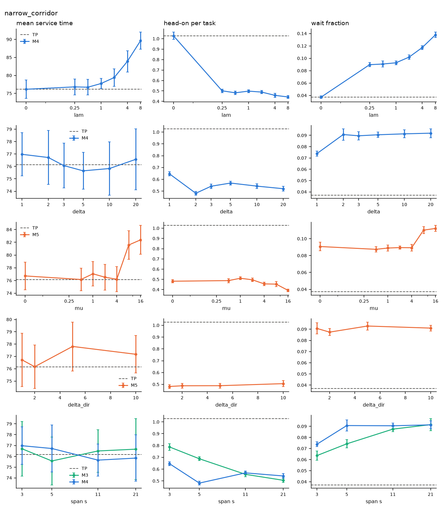
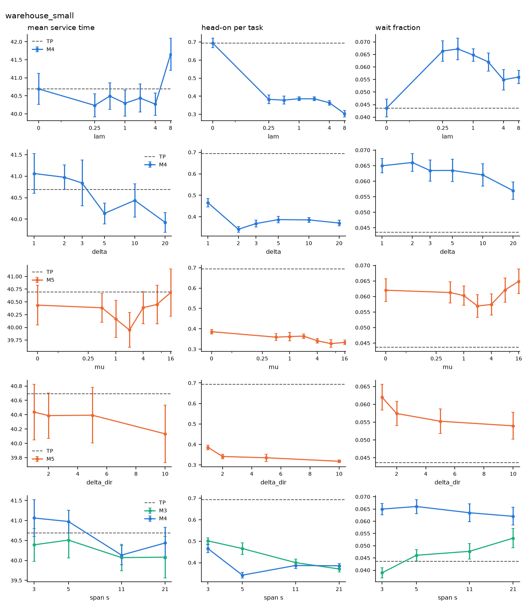

# M3-M5 sensitivity and the matched-window M3 -> M4 comparison

## Design (fixed 2026-11-24, before any run of this study)

**Purpose.** Show how much the results depend on lam, delta, mu and delta_dir, and
compare M3 with M4 at equal window length. Tuning on narrow_corridor gave M3 a 2-step
window and M4 a 5-step span (delta = 2), so comparing the tuned methods mixes window
size with time resolution. These runs use **test seeds**, but nothing from them changes
the parameters chosen in `tune_foresight.md`; they are reported as they come out.

**Setting.** Both maps; one medium configuration: 30 agents, 1 task per step, 500
tasks; test seeds 0-9. Every run must complete with 0 conflicts.

**One-at-a-time sweeps** around each map's tuned point (narrow: M4 lam = 0.5, delta = 2;
M5 adds mu = 0.5. Warehouse: M4 lam = 2, delta = 10; M5 adds mu = 4. delta_dir = 2):

| sweep | method | varied | values | fixed |
|---|---|---|---|---|
| lam | M4 | lam | 0, 0.25, 0.5, 1, 2, 4, 8 | tuned delta |
| delta | M4 | delta | 1, 2, 3, 5, 10, 20 | tuned lam |
| mu | M5 | mu | 0, 0.5, 1, 2, 4, 8, 16 | tuned lam, delta |
| delta_dir | M5 | delta_dir | 1, 2, 5, 10 | tuned lam, delta, mu |
| matched | M3 and M4 | span s = W = 2 delta + 1 | s = 3, 5, 11, 21 (delta = 1, 2, 5, 10) | lam = M4's tuned lam |

lam = 0 (M4) and mu = 0 (M5) are exactly TP and M4, by the consistency test; they anchor
the curves. delta_dir was never tuned (fixed at 2), so its sweep also shows whether that
choice matters.

**Metrics.** Mean service time, head-on encounters per task and wait fraction (mean and
95% CI over the 10 seeds), with TP as a reference line; planning time per step.

**Matched-window test (the M3 -> M4 ablation).** For each map and span s, paired by
seed, Wilcoxon signed-rank, two-sided:

- **A1:** head-on encounters per task, M4 < M3.
- **A2:** mean service time, M4 vs M3 (no direction predicted).

Reported per span and pooled over the four spans (40 pairs per map). A1 is the claim
"time resolution, not window size, removes the extra encounters".

# Findings (written 2026-11-24, after the runs)

1. **delta_dir = 1 switches M5 off.** M5 with delta_dir = 1 gave exactly M4's
   trajectories on every seed of both maps. That is not a bug but geometry: a reverse
   move v -> u at t - 1 puts that robot at u at time t, and one at t + 1 puts it at v at
   t + 1, so both are vertex conflicts with u -> v at t. Every move A* may take
   therefore has c_opp = 0. Design decision 4 ("delta_dir >= 1") must read
   **delta_dir >= 2**. Our runs all used 2, so no result changes. The docstring is
   fixed, and a regression test (`test_delta_dir_one_makes_m5_identical_to_m4`) pins it.
2. **lam works like a switch.** Any lam >= 0.25 already gives nearly the full
   encounter cut (narrow -51%, warehouse -45% vs TP). Larger lam adds little and, on
   narrow_corridor, costs service time (lam = 4: +10%, lam = 8: +18%). Waiting jumps
   as soon as lam > 0. The penalty mostly acts as a tie-breaker between equally short
   options, waiting included.
3. **delta = 2 gives the fewest encounters on both maps** (narrow 0.482, warehouse
   0.342 per task); delta = 1 is clearly weaker, and 3-20 is flat. Warehouse's tuned
   delta = 10 (chosen on service time) has 13% more encounters than delta = 2 here, for
   a 1.3% lower service time.
4. **mu matters only on warehouse.** Every mu > 0 cuts encounters 6-15% below M4
   there, with no cost in service time or waiting. Larger delta_dir helps further
   (delta_dir = 10: -18% vs M4). On narrow_corridor mu <= 4 changes nothing; mu >= 8
   cuts more but costs +6-7% service time, and delta_dir has no effect. This agrees with
   `lanes_warehouse.md` (finding 5): the directional term pays off on wide aisles.
   delta_dir was never tuned. The sweep suggests a larger value would help on warehouse,
   but changing it now would mean re-tuning, which needs a team decision.
5. **A1 holds pooled, but only for short windows.** At equal span, M4 has fewer
   encounters than M3 pooled over spans: narrow -12%, warehouse -9% (both p = 0.001).
   All of it comes from s = 3 and 5 (narrow -18% / -30%, warehouse -7% / -27%, 10/10 or
   8/10 seeds). At s = 11 there is no difference, and at s = 21 M3 is slightly better
   (narrow +7% for M4, p = 0.027). With a long window, "busy at my arrival" and "busy
   soon" carry the same information. Best against best: M4 at s = 5 has 5% (narrow)
   and 8% (warehouse) fewer encounters than M3's best (s = 21).
6. **A2: no service-time gain from time resolution.** Narrow: no difference (p = 0.55).
   Warehouse: M4 +1.0% (9/40 seeds lower, p = 1e-4), from the short spans, where M4
   also waits more.

**For the report.** Contribution 1 should be stated as "a time-resolved window removes
more encounters than a look-ahead window of the same length, when the window is short
(s <= 5)". The best M4 beats the best M3 by 5-8% on encounters, with no service-time
gain. Method section: state delta_dir >= 2 (with the one-line proof above) next to
delta >= 1.

# Results

660 runs (test seeds 0-9, 30 agents, rate 1), all complete with 0 conflicts. Produced by `python experiments/sensitivity.py summarize results/sensitivity.csv --out results/summary/sensitivity`. Cells: mean ± 95% CI.

## narrow_corridor

TP: mean service time 76.2, head-on per task 1.028, wait fraction 0.037, ms/step 0.27.

### lam

| method | lam | mean service time | head-on per task | wait fraction | ms/step |
|---|---:|---:|---:|---:|---:|
| M4 | 0 | 76.2 ± 2.6 | 1.028 ± 0.035 | 0.037 ± 0.002 | 0.31 ± 0.02 |
| M4 | 0.25 | 76.8 ± 2.2 | 0.501 ± 0.017 | 0.090 ± 0.003 | 0.47 ± 0.04 |
| M4 | 0.5 | 76.7 ± 2.2 | 0.482 ± 0.016 | 0.091 ± 0.005 | 0.48 ± 0.02 |
| M4 | 1 | 77.7 ± 1.4 | 0.498 ± 0.014 | 0.093 ± 0.003 | 0.48 ± 0.03 |
| M4 | 2 | 79.4 ± 2.4 | 0.489 ± 0.016 | 0.102 ± 0.004 | 0.53 ± 0.04 |
| M4 | 4 | 83.9 ± 3.0 | 0.458 ± 0.019 | 0.117 ± 0.003 | 0.58 ± 0.04 |
| M4 | 8 | 89.6 ± 2.4 | 0.442 ± 0.015 | 0.138 ± 0.004 | 0.64 ± 0.06 |

### delta

| method | delta | mean service time | head-on per task | wait fraction | ms/step |
|---|---:|---:|---:|---:|---:|
| M4 | 1 | 77.0 ± 1.7 | 0.646 ± 0.017 | 0.074 ± 0.002 | 0.46 ± 0.03 |
| M4 | 2 | 76.7 ± 2.2 | 0.482 ± 0.016 | 0.091 ± 0.005 | 0.48 ± 0.03 |
| M4 | 3 | 76.1 ± 1.8 | 0.542 ± 0.018 | 0.090 ± 0.004 | 0.48 ± 0.02 |
| M4 | 5 | 75.6 ± 1.5 | 0.568 ± 0.016 | 0.091 ± 0.002 | 0.48 ± 0.02 |
| M4 | 10 | 75.8 ± 2.1 | 0.542 ± 0.020 | 0.091 ± 0.003 | 0.51 ± 0.02 |
| M4 | 20 | 76.6 ± 2.5 | 0.521 ± 0.020 | 0.092 ± 0.004 | 0.52 ± 0.03 |

### mu

| method | mu | mean service time | head-on per task | wait fraction | ms/step |
|---|---:|---:|---:|---:|---:|
| M5 | 0 | 76.7 ± 2.2 | 0.482 ± 0.016 | 0.091 ± 0.005 | 0.48 ± 0.02 |
| M5 | 0.5 | 76.2 ± 1.8 | 0.488 ± 0.020 | 0.087 ± 0.003 | 0.60 ± 0.02 |
| M5 | 1 | 77.1 ± 1.9 | 0.511 ± 0.015 | 0.089 ± 0.003 | 0.61 ± 0.03 |
| M5 | 2 | 76.5 ± 2.0 | 0.496 ± 0.017 | 0.089 ± 0.002 | 0.62 ± 0.04 |
| M5 | 4 | 76.2 ± 2.0 | 0.456 ± 0.016 | 0.089 ± 0.004 | 0.64 ± 0.03 |
| M5 | 8 | 81.6 ± 2.2 | 0.454 ± 0.025 | 0.110 ± 0.004 | 0.70 ± 0.05 |
| M5 | 16 | 82.4 ± 2.3 | 0.392 ± 0.013 | 0.112 ± 0.004 | 0.73 ± 0.06 |

### delta_dir

| method | delta_dir | mean service time | head-on per task | wait fraction | ms/step |
|---|---:|---:|---:|---:|---:|
| M5 | 1 | 76.7 ± 2.2 | 0.482 ± 0.016 | 0.091 ± 0.005 | 0.60 ± 0.04 |
| M5 | 2 | 76.2 ± 1.8 | 0.488 ± 0.020 | 0.087 ± 0.003 | 0.59 ± 0.03 |
| M5 | 5 | 77.8 ± 2.0 | 0.489 ± 0.020 | 0.093 ± 0.004 | 0.62 ± 0.04 |
| M5 | 10 | 77.2 ± 1.5 | 0.506 ± 0.025 | 0.091 ± 0.003 | 0.65 ± 0.04 |

### matched

| method | span s = W = 2 delta + 1 | mean service time | head-on per task | wait fraction | ms/step |
|---|---:|---:|---:|---:|---:|
| M3 | 3 | 76.7 ± 2.5 | 0.788 ± 0.028 | 0.064 ± 0.004 | 0.47 ± 0.03 |
| M4 | 3 | 77.0 ± 1.7 | 0.646 ± 0.017 | 0.074 ± 0.002 | 0.46 ± 0.03 |
| M3 | 5 | 75.6 ± 2.2 | 0.688 ± 0.016 | 0.074 ± 0.004 | 0.46 ± 0.03 |
| M4 | 5 | 76.7 ± 2.2 | 0.482 ± 0.016 | 0.091 ± 0.005 | 0.48 ± 0.03 |
| M3 | 11 | 76.5 ± 2.0 | 0.556 ± 0.019 | 0.088 ± 0.002 | 0.47 ± 0.02 |
| M4 | 11 | 75.6 ± 1.5 | 0.568 ± 0.016 | 0.091 ± 0.002 | 0.49 ± 0.03 |
| M3 | 21 | 76.7 ± 2.8 | 0.506 ± 0.019 | 0.092 ± 0.005 | 0.47 ± 0.03 |
| M4 | 21 | 75.8 ± 2.1 | 0.542 ± 0.020 | 0.091 ± 0.003 | 0.52 ± 0.02 |

### Matched-window tests (M4 - M3, paired by seed)

| test | metric | span | pairs | mean M4 - M3 | relative | M4 lower | p (Wilcoxon) |
|---|---|---|---:|---:|---:|---:|---:|
| A1 | head_on_per_task | pooled | 40 | -0.0748 | -11.8% | 25/40 | 0.00109 |
| A1 | head_on_per_task | 3 | 10 | -0.1418 | -18.0% | 10/10 | 0.00195 |
| A1 | head_on_per_task | 5 | 10 | -0.2060 | -29.9% | 10/10 | 0.00195 |
| A1 | head_on_per_task | 11 | 10 | +0.0122 | +2.2% | 3/10 | 0.432 |
| A1 | head_on_per_task | 21 | 10 | +0.0366 | +7.2% | 2/10 | 0.0273 |
| A2 | service_time_mean | pooled | 40 | -0.0593 | -0.1% | 23/40 | 0.554 |
| A2 | service_time_mean | 3 | 10 | +0.2840 | +0.4% | 4/10 | 0.695 |
| A2 | service_time_mean | 5 | 10 | +1.1522 | +1.5% | 5/10 | 0.375 |
| A2 | service_time_mean | 11 | 10 | -0.8464 | -1.1% | 7/10 | 0.105 |
| A2 | service_time_mean | 21 | 10 | -0.8270 | -1.1% | 7/10 | 0.232 |

## warehouse_small

TP: mean service time 40.7, head-on per task 0.694, wait fraction 0.044, ms/step 0.46.

### lam

| method | lam | mean service time | head-on per task | wait fraction | ms/step |
|---|---:|---:|---:|---:|---:|
| M4 | 0 | 40.7 ± 0.4 | 0.694 ± 0.026 | 0.044 ± 0.003 | 0.50 ± 0.04 |
| M4 | 0.25 | 40.2 ± 0.3 | 0.383 ± 0.024 | 0.066 ± 0.004 | 0.89 ± 0.04 |
| M4 | 0.5 | 40.5 ± 0.4 | 0.378 ± 0.022 | 0.067 ± 0.004 | 0.91 ± 0.07 |
| M4 | 1 | 40.3 ± 0.4 | 0.386 ± 0.011 | 0.065 ± 0.002 | 0.91 ± 0.05 |
| M4 | 2 | 40.4 ± 0.4 | 0.386 ± 0.011 | 0.062 ± 0.004 | 1.02 ± 0.05 |
| M4 | 4 | 40.3 ± 0.3 | 0.364 ± 0.012 | 0.055 ± 0.004 | 1.19 ± 0.05 |
| M4 | 8 | 41.7 ± 0.4 | 0.303 ± 0.017 | 0.056 ± 0.003 | 1.55 ± 0.06 |

### delta

| method | delta | mean service time | head-on per task | wait fraction | ms/step |
|---|---:|---:|---:|---:|---:|
| M4 | 1 | 41.1 ± 0.5 | 0.465 ± 0.019 | 0.065 ± 0.002 | 0.85 ± 0.04 |
| M4 | 2 | 41.0 ± 0.3 | 0.342 ± 0.013 | 0.066 ± 0.003 | 0.86 ± 0.03 |
| M4 | 3 | 40.8 ± 0.5 | 0.369 ± 0.016 | 0.063 ± 0.003 | 0.92 ± 0.06 |
| M4 | 5 | 40.1 ± 0.2 | 0.387 ± 0.015 | 0.063 ± 0.004 | 0.99 ± 0.05 |
| M4 | 10 | 40.4 ± 0.4 | 0.386 ± 0.011 | 0.062 ± 0.004 | 1.04 ± 0.04 |
| M4 | 20 | 39.9 ± 0.2 | 0.371 ± 0.013 | 0.057 ± 0.003 | 1.01 ± 0.04 |

### mu

| method | mu | mean service time | head-on per task | wait fraction | ms/step |
|---|---:|---:|---:|---:|---:|
| M5 | 0 | 40.4 ± 0.4 | 0.386 ± 0.011 | 0.062 ± 0.004 | 1.06 ± 0.05 |
| M5 | 0.5 | 40.4 ± 0.3 | 0.359 ± 0.016 | 0.061 ± 0.003 | 1.37 ± 0.04 |
| M5 | 1 | 40.2 ± 0.4 | 0.362 ± 0.021 | 0.060 ± 0.003 | 1.36 ± 0.08 |
| M5 | 2 | 39.9 ± 0.3 | 0.364 ± 0.011 | 0.057 ± 0.004 | 1.37 ± 0.07 |
| M5 | 4 | 40.4 ± 0.3 | 0.341 ± 0.012 | 0.057 ± 0.003 | 1.43 ± 0.09 |
| M5 | 8 | 40.4 ± 0.4 | 0.327 ± 0.019 | 0.062 ± 0.004 | 1.50 ± 0.07 |
| M5 | 16 | 40.7 ± 0.5 | 0.333 ± 0.012 | 0.065 ± 0.004 | 1.46 ± 0.08 |

### delta_dir

| method | delta_dir | mean service time | head-on per task | wait fraction | ms/step |
|---|---:|---:|---:|---:|---:|
| M5 | 1 | 40.4 ± 0.4 | 0.386 ± 0.011 | 0.062 ± 0.004 | 1.37 ± 0.07 |
| M5 | 2 | 40.4 ± 0.3 | 0.341 ± 0.012 | 0.057 ± 0.003 | 1.45 ± 0.08 |
| M5 | 5 | 40.4 ± 0.4 | 0.335 ± 0.018 | 0.055 ± 0.003 | 1.47 ± 0.08 |
| M5 | 10 | 40.1 ± 0.4 | 0.318 ± 0.007 | 0.054 ± 0.004 | 1.48 ± 0.10 |

### matched

| method | span s = W = 2 delta + 1 | mean service time | head-on per task | wait fraction | ms/step |
|---|---:|---:|---:|---:|---:|
| M3 | 3 | 40.4 ± 0.4 | 0.501 ± 0.014 | 0.039 ± 0.002 | 1.04 ± 0.03 |
| M4 | 3 | 41.1 ± 0.5 | 0.465 ± 0.019 | 0.065 ± 0.002 | 0.89 ± 0.05 |
| M3 | 5 | 40.5 ± 0.4 | 0.466 ± 0.027 | 0.046 ± 0.002 | 1.05 ± 0.05 |
| M4 | 5 | 41.0 ± 0.3 | 0.342 ± 0.013 | 0.066 ± 0.003 | 0.91 ± 0.04 |
| M3 | 11 | 40.1 ± 0.3 | 0.400 ± 0.017 | 0.048 ± 0.003 | 1.15 ± 0.08 |
| M4 | 11 | 40.1 ± 0.2 | 0.387 ± 0.015 | 0.063 ± 0.004 | 1.30 ± 0.09 |
| M3 | 21 | 40.1 ± 0.5 | 0.371 ± 0.015 | 0.053 ± 0.004 | 1.16 ± 0.07 |
| M4 | 21 | 40.4 ± 0.4 | 0.386 ± 0.011 | 0.062 ± 0.004 | 0.96 ± 0.07 |

### Matched-window tests (M4 - M3, paired by seed)

| test | metric | span | pairs | mean M4 - M3 | relative | M4 lower | p (Wilcoxon) |
|---|---|---|---:|---:|---:|---:|---:|
| A1 | head_on_per_task | pooled | 40 | -0.0396 | -9.1% | 28/40 | 0.00109 |
| A1 | head_on_per_task | 3 | 10 | -0.0360 | -7.2% | 8/10 | 0.0273 |
| A1 | head_on_per_task | 5 | 10 | -0.1238 | -26.6% | 10/10 | 0.00195 |
| A1 | head_on_per_task | 11 | 10 | -0.0134 | -3.3% | 7/10 | 0.242 |
| A1 | head_on_per_task | 21 | 10 | +0.0148 | +4.0% | 3/10 | 0.0801 |
| A2 | service_time_mean | pooled | 40 | +0.3887 | +1.0% | 9/40 | 0.000101 |
| A2 | service_time_mean | 3 | 10 | +0.6720 | +1.7% | 1/10 | 0.00391 |
| A2 | service_time_mean | 5 | 10 | +0.4652 | +1.1% | 1/10 | 0.00977 |
| A2 | service_time_mean | 11 | 10 | +0.0624 | +0.2% | 4/10 | 0.625 |
| A2 | service_time_mean | 21 | 10 | +0.3552 | +0.9% | 3/10 | 0.16 |

## Figures

